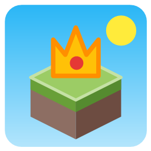

<p align="center">
  
</p>

<h1 align="center">Minecraft Little Admin</h1>

A small, kid-friendly control panel for Minecraft LAN games. Instead of typing commands, players tap big colorful buttons and the app sends the matching command to Minecraft:

| Button   | Command                  |
|----------|--------------------------|
| Day      | `time set day`           |
| Night    | `time set night`         |
| Rain     | `weather rain`           |
| No Rain  | `weather clear`          |
| Storm    | `weather thunder`        |
| Survival | `gamemode survival @s`   |
| Creative | `gamemode creative @s`   |

Built for parents and kids who play together, so the youngest player can control the world too.

## How it works

Minecraft for Windows (Bedrock Edition) has no RCON, but it can connect to a WebSocket server with the `/connect` chat command. Minecraft Little Admin runs that server (port 3000, or the next free port), and every button press is sent to the game as if the host player had typed the command.

## Setup (grown-up steps)

The app runs on the same PC as the host's Minecraft and only accepts connections from that PC.

**One time only:**

- In Minecraft: **Settings → General**, turn **off** "Require Encrypted Websockets".
- Turn **cheats on** for the world (it's saved with the world).

**Every time you play:**

1. Open your world in Minecraft.
2. Start **Minecraft Little Admin** and press **Connect to Minecraft**.
   The app switches to Minecraft, opens chat, pastes `/connect 127.0.0.1:3000` and presses Enter for you.
3. The app turns green: "Connected". Hand it to the kids!

Minecraft doesn't remember `/connect`, so it's needed each time a world is opened. The button does the typing for you. You can still type the command yourself (it's shown in the app).

Only the host does this. The weather and time change for everyone in the LAN game, but Survival and Creative only switch the host player's game mode.

### If it doesn't connect

Some Minecraft builds block connections to apps on the same computer. Allow it once from an admin terminal:

```
CheckNetIsolation LoopbackExempt -a -n=Microsoft.MinecraftUWP_8wekyb3d8bbwe
```

## Build

Requires the .NET 10 SDK on Windows.

```
dotnet build
dotnet run --project MinecraftLittleAdmin
```
